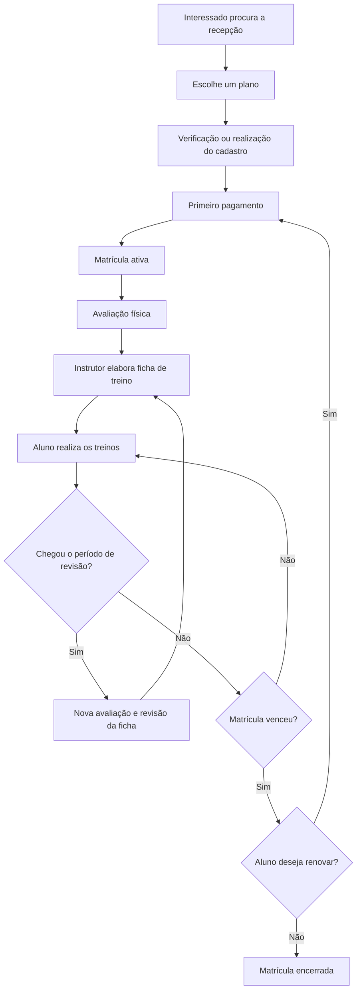

# Modelagem de Banco de Dados para a X Personal Studio

### Entrega 2 — Modelo Lógico, Implementação SQL e Apresentação Final

## Integrantes

| Nome completo do aluno | RGM | Usuário do GitHub |
| :---- | :---- | :---- |
| Guilherme Lima de Souza | 47622814 | [giuerme](https://github.com/giuerme) |
| Guilherme Miranda Sena | 47401672 | [mirandadev-creator](https://github.com/mirandadev-creator) |
| Guilherme Vilela Frassão | 47911522 | [guilherme-vilelaf](https://github.com/guilherme-vilelaf) |
| Nathan de Oliveira Tavares | 47916966 | [ghost-nana](https://github.com/ghost-nana) |
| Kaue Dogani Moreira | 47312998 | [kauedogani](https://github.com/kauedogani) |

---

## Sumário

1. [Relatório Técnico Final](#1-relatório-técnico-final)
   - [1.1 Revisão do Modelo Conceitual](#11-revisão-do-modelo-conceitual)
   - [1.2 Conversão do Modelo Conceitual para o Modelo Lógico](#12-conversão-do-modelo-conceitual-para-o-modelo-lógico)
   - [1.3 Definição de Chaves Primárias e Estrangeiras](#13-definição-de-chaves-primárias-e-estrangeiras)
   - [1.4 Processo de Normalização (1FN, 2FN e 3FN)](#14-processo-de-normalização-1fn-2fn-e-3fn)
   - [1.5 Justificativas Técnicas das Decisões](#15-justificativas-técnicas-das-decisões)
   - [1.6 Proposta de Arquitetura Analítica para BI e IA](#16-proposta-de-arquitetura-analítica-para-bi-e-ia)
2. [Modelo Lógico Relacional](#2-modelo-lógico-relacional)
3. [Script SQL Completo](#3-script-sql-completo)
4. [Massa de Dados](#4-massa-de-dados)
5. [Repositório GitHub](#5-repositório-github)
6. [Uso de Inteligência Artificial](#6-uso-de-inteligência-artificial)
7. [Apresentação Corporativa Final](#7-apresentação-corporativa-final)

---

## 1. Relatório Técnico Final

Este projeto modela o banco de dados de um sistema de gerenciamento de informações para a **X Personal Studio**, academia de musculação localizada em São Paulo - SP. Na Entrega 1 foram feitos o levantamento de requisitos, as regras de negócio, o Dicionário de Dados e o DER conceitual. Nesta **Entrega 2**, o modelo foi revisado e o projeto avançou até o modelo lógico, a normalização, o script SQL com massa de dados e as consultas gerenciais e de auditoria.

### 1.1 Revisão do Modelo Conceitual

#### Caracterização da organização

| Item | Informação |
|---|---|
| **Nome** | X Personal Studio |
| **Natureza** | Academia de musculação, com fins lucrativos (organização real) |
| **Endereço** | R. Refinaria Mataripe, 577 - Vila Antonieta, São Paulo - SP, 03477-010 |
| **Contato** | (11) 97730-5571 |
| **Responsável** | "Wolverine" — dono da academia (apelido adotado a pedido do próprio responsável, que não quis ser identificado) |
| **Porte** | Pequeno: 3 funcionários (instrutores, incluindo o dono) e cerca de 200 frequentadores inscritos |
| **Público** | Principalmente moradores do bairro |
| **Planos oferecidos** | 2: mensal e anual |

**Problemas e necessidades identificados**

Hoje o cadastro dos frequentadores é feito em um sistema de terceiros e as fichas de treino são guardadas em papel. Isso gera os problemas abaixo, cada um resolvido por uma parte do modelo (ver tabela de rastreabilidade na seção 1.6).

| Código | Problema | Origem | Onde o modelo resolve |
|---|---|---|---|
| **P1** | Fichas de treino em papel, difíceis de organizar e consultar quando se acumulam. Nas palavras do dono: "fico perdido quando as fichas acumulam demais". | Entrevista | Entidades Ficha de Treino, Exercício e Ficha_Exercício |
| **P2** | As fichas em papel exigem espaço físico, e o local é pequeno. | Entrevista e observação | Armazenamento digital das fichas (Ficha de Treino) |
| **P3** | O cadastro dos frequentadores fica em sistema de terceiros, sem integração com planos, pagamentos, fichas e avaliações. | Entrevista | Frequentador como entidade central, ligada a todas as demais |
| **P4** | Falta de controle unificado de matrículas, vencimentos e pagamentos por frequentador. | Análise do grupo | Entidades Plano, Matrícula e Pagamento |
| **P5** | Falta de histórico organizado das avaliações físicas para acompanhar a evolução do frequentador. | Análise do grupo | Entidade Avaliação Física |

**Escopo do sistema.** O banco reúne todos os dados da academia, e não só os de um setor: frequentadores, planos, matrículas, pagamentos, funcionários, avaliações físicas, fichas de treino e exercícios (9 entidades).

**Justificativa da escolha.** A academia é de fácil acesso e o responsável se dispôs a colaborar. Há relações claras entre planos, matrículas, pagamentos, treinos e avaliações, o que a torna um bom caso de modelagem. O fluxo de informações sobre alunos e instrutores é constante, o que justifica um banco unificado para armazenar, consultar e atualizar esses registros. Nenhum integrante do grupo trabalha na academia nem tem vínculo familiar com o responsável.

**Evidências da organização**

- Fotos do ambiente e fotos com o dono: [diretório de imagens](./dicio_dados/imgs)
- Foto da entrevista com o responsável: [ver imagem](./dicio_dados/imgs/FotoDono.jpeg.jpeg)

#### Relato da entrevista

O levantamento completo, escrito pelo grupo, está em [`levantamento/levantamento.md`](./levantamento/levantamento.md). Resumo:

| Item | 1ª visita | 2ª visita |
|---|---|---|
| **Data** | 11/09/2026 | 02/10/2026 |
| **Local e forma** | Na academia, presencial | Na academia, presencial |
| **Entrevistado** | Wolverine, dono | Wolverine, dono |
| **Integrantes presentes** | Nathan de Oliveira Tavares, Guilherme Miranda Sena e Guilherme Silva | Guilherme Miranda Sena |
| **Comprovação** | [Ver imagem](./dicio_dados/imgs/FotoDono.jpeg.jpeg) | [Ver imagens](./dicio_dados/imgs) |

**Achados obtidos pelas respostas do entrevistado**

- O dono aceitou ajudar e facilitar o trabalho do grupo.
- A academia é totalmente focada em musculação e tem 3 instrutores especialistas.
- A matrícula usa o CPF como base, com nome completo, data de nascimento e foto do interessado.
- Existe um plano de inscrição próprio, com duas modalidades de pagamento: mensal e anual.
- A ficha de treino é montada conforme o objetivo do interessado (por exemplo, ganhar massa ou emagrecer), em papel.
- Todos os funcionários têm as mesmas funções e responsabilidades, mesmo em níveis hierárquicos diferentes.

**Achados obtidos pela observação presencial**

- O espaço físico é pequeno, o que torna difícil guardar fichas em papel (P2).
- Os funcionários, incluindo o dono, atuam também como personal trainers, o que confirma que todos podem elaborar fichas e conduzir avaliações.

**O que mudou da Entrega 1 para a Entrega 2:** os pontos que as entrevistas não detalharam (formas de pagamento, avaliação física e periodicidade de revisão das fichas) deixaram de ser pendências e passaram a ser decisões de modelagem documentadas. O banco registra forma de pagamento e status em cada pagamento, guarda cada avaliação como histórico e registra datas de criação e revisão da ficha, de modo que a gestão pode acompanhar os prazos por consulta.

#### Processos de negócio

Os processos abaixo descrevem a operação com base nas entrevistas (AS-IS) e como o banco passa a registrá-los.
##### P1:
**Matrícula e pagamento**

1. O interessado procura a academia para conhecer os planos (mensal ou anual).
2. O cadastro é feito com CPF, nome completo, data de nascimento, telefone e foto. Hoje fica em sistema de terceiros; no banco passa a ser a entidade Frequentador.
3. O frequentador escolhe o plano e a matrícula é criada com data de início, data final (início + duração do plano) e status "ativa".
4. Cada cobrança é registrada como um pagamento da matrícula, com valor, data de vencimento, forma de pagamento, status (pendente, pago ou atrasado) e, quando pago, a data de pagamento. O plano mensal gera uma cobrança por mês e o anual, uma cobrança por ano.
5. Ao fim do período, a matrícula vence. Se o frequentador renova, uma nova matrícula é criada, e a anterior permanece como histórico. Se não renova, a matrícula fica "vencida" e o frequentador permanece cadastrado como inativo.

#### P2:
**Avaliação física**

1. Um funcionário avalia o frequentador e registra data, peso, altura, percentual de gordura e observações médicas.
2. Cada avaliação gera um novo registro, e as anteriores nunca são sobrescritas, o que forma o histórico de evolução (P5).
3. Esse processo não foi detalhado pelo dono nas entrevistas. Ele foi incluído no modelo porque o acompanhamento da evolução do aluno é parte típica de uma academia de musculação e sustenta a montagem e a revisão das fichas.

#### P3:
**Ficha de treino**

1. O frequentador informa seu objetivo (por exemplo, ganhar massa ou emagrecer).
2. Um instrutor seleciona os exercícios adequados e define, para cada um, séries, repetições, carga e ordem.
3. Hoje a ficha é feita em papel e entregue ao frequentador, e as fichas ficam guardadas fisicamente (P1 e P2). No banco, cada ficha tem objetivo, data de criação, data de revisão e instrutor responsável.
4. A periodicidade de revisão não foi definida pelo dono. O banco registra as datas e deixa o prazo como parâmetro da consulta G08, que lista as fichas sem revisão há mais de N dias.

#### P4:
**Fluxo geral**



#### P5:
**Problemas do processo atual e benefício do banco**

| Etapa | Problema atual | Benefício com o banco de dados |
|---|---|---|
| Cadastro | Dados em sistema de terceiros, sem integração (P3). | Dados dos frequentadores centralizados em banco próprio. |
| Matrícula | Dados de planos e inscrições dispersos (P4). | Controle de matrículas, planos, datas e situação de cada frequentador. |
| Pagamento | Informações financeiras difíceis de consultar (P4). | Pagamentos por matrícula, com valor, vencimento, forma e status. |
| Avaliação física | Sem histórico organizado (P5). | Consulta do histórico de avaliações físicas. |
| Ficha de treino | Fichas em papel, difíceis de organizar e de guardar (P1 e P2). | Fichas, exercícios e datas de revisão armazenados digitalmente. |

**Processos típicos de academias que não foram incluídos**

| Processo | Por que não foi incluído |
|---|---|
| Controle de acesso (catraca) e frequência diária | Não foi citado pela organização. O modelo permite incluí-lo depois sem refazer a estrutura (RNF07). |
| Venda de produtos e controle de estoque | Não foi citado pela organização como necessidade. |
| Compras de fornecedores | Não foi citado pela organização. |
| Folha de pagamento e escala da equipe | Equipe de 3 pessoas com as mesmas funções, sem necessidade citada. |
| Agendamento de aulas ou horários | A academia é focada em musculação com treino por ficha, e não foi citado agendamento. |

#### Requisitos

**Requisitos Funcionais**

| ID | Requisito |
|---|---|
| RF01 | Cadastrar frequentador com nome completo, CPF, data de nascimento, telefone, foto e situação (ativo ou inativo). |
| RF02 | Cadastrar plano com nome, duração em meses, valor e situação (ativo ou inativo). |
| RF03 | Cadastrar matrícula com frequentador, plano, data de início, data final e status. |
| RF04 | Registrar pagamento de cada matrícula com valor, data de vencimento, data de pagamento, forma de pagamento e status. |
| RF05 | Consultar frequentadores com pagamento em atraso e matrículas próximas do vencimento. |
| RF06 | Atualizar o status da matrícula (ativa, vencida, trancada ou cancelada). |
| RF07 | Cadastrar funcionário com nome completo, CPF, cargo, especialidade e senha (armazenada em hash). |
| RF08 | Cadastrar exercício com nome e grupo muscular. |
| RF09 | Criar ficha de treino para um frequentador, com objetivo, data de criação, data de revisão e o funcionário responsável. |
| RF10 | Associar exercícios à ficha com séries, repetições, carga e ordem. |
| RF11 | Registrar avaliação física com frequentador, funcionário avaliador, data, peso, altura, percentual de gordura e observações médicas. |
| RF12 | Consultar o histórico de avaliações e de fichas de um frequentador. |
| RF13 | Inativar frequentador ou plano em vez de excluí-lo, preservando o histórico. |

**Requisitos Não Funcionais**

| ID | Categoria | Requisito |
|---|---|---|
| RNF01 | Segurança | Senhas armazenadas somente como hash, nunca em texto puro. |
| RNF02 | Integridade | Toda entidade possui identificador único (PK) e FKs com integridade referencial. |
| RNF03 | Identificação | CPF único para frequentador e para funcionário. |
| RNF04 | Confiabilidade | Backup periódico e transações para evitar perda ou alteração indevida. |
| RNF05 | Usabilidade | Cadastros e consultas simples para recepção e instrutores. |
| RNF06 | Privacidade (LGPD) | Dados pessoais e observações médicas acessíveis apenas a perfis autorizados. |
| RNF07 | Manutenibilidade | Estrutura extensível (por exemplo, controle de acesso por catraca) sem refazer o modelo. |
| RNF08 | Rastreabilidade | Datas de criação, revisão, início, fim e avaliação armazenadas, e alterações críticas registradas em log. |

**Cobertura dos problemas pelos requisitos:** P1 e P2 (RF08, RF09, RF10, RF12), P3 (RF01, RF07, RNF02), P4 (RF02 a RF06, RF13) e P5 (RF11, RF12).

**Requisitos típicos não incluídos**

| Requisito | Por que não foi incluído |
|---|---|
| Emissão de nota fiscal | Não foi citada como necessidade pela organização. |
| Integração com gateway de pagamento ou cobrança automática | Não foi citada pela organização; o banco apenas registra os pagamentos. |
| Controle de acesso por catraca | Fora do escopo desta etapa (ver RNF07). |
| Agendamento de horários ou aulas | O processo não existe na organização. |

#### Regras de negócio

| ID | Regra | Entidades |
|---|---|---|
| RN01 | Cada frequentador e cada funcionário é identificado por CPF único. | Frequentador, Funcionário |
| RN02 | Uma matrícula pertence a exatamente um frequentador e a exatamente um plano. | Matrícula |
| RN03 | Um frequentador pode ter várias matrículas ao longo do tempo (renovações), mas **no máximo uma com status "ativa"** por vez. | Matrícula |
| RN04 | A data final da matrícula é igual ou posterior à data de início. | Matrícula |
| RN05 | O status da matrícula assume apenas: ativa, vencida, trancada, cancelada. | Matrícula |
| RN06 | Uma matrícula é considerada "vencida" quando a data final passa sem renovação. | Matrícula |
| RN07 | Cada pagamento pertence a exatamente uma matrícula e tem valor maior que zero. | Pagamento |
| RN08 | O status do pagamento é: pendente, pago ou atrasado; "pago" exige data de pagamento. | Pagamento |
| RN09 | Um pagamento "pendente" cujo vencimento passou é tratado como "atrasado". | Pagamento |
| RN10 | O valor do pagamento é registrado no momento da cobrança, mesmo que o preço do plano mude depois. | Pagamento, Plano |
| RN11 | Planos podem ser descontinuados (inativos), mas não excluídos se houver matrículas associadas. | Plano |
| RN12 | Toda ficha de treino pertence a um frequentador e é elaborada por um funcionário com cargo de instrutor. | Ficha, Funcionário |
| RN13 | A data de revisão da ficha é igual ou posterior à data de criação. | Ficha de Treino |
| RN14 | Uma ficha contém um ou mais exercícios; o mesmo exercício pode aparecer em várias fichas. | Ficha, Exercício |
| RN15 | Toda avaliação física pertence a exatamente um frequentador e é conduzida por exatamente um funcionário. | Avaliação |
| RN16 | Avaliações são mantidas como histórico: não são sobrescritas, e uma nova avaliação gera novo registro. | Avaliação |
| RN17 | Peso, altura e percentual de gordura devem ser valores positivos (gordura entre 0 e 100). | Avaliação |
| RN18 | Não é permitido excluir frequentador que possua matrículas, fichas ou avaliações; ele é **inativado**. | Frequentador |
| RN19 | Observações médicas são dado sensível: só instrutores e administrador podem consultá-las. | Avaliação |
| RN20 | A senha do funcionário é armazenada em hash e nunca exibida. | Funcionário |
| RN21 | Dados de exemplo em documentos do projeto são fictícios. | — |

**Regras típicas não incluídas**

| Regra | Por que não foi incluída |
|---|---|
| Idade mínima para matrícula | Não foi citada pela organização; o cadastro registra a data de nascimento, o que permite adotá-la depois. |
| Bloqueio de acesso por inadimplência | Depende de controle de acesso por catraca, que está fora do escopo (RNF07). |
| Emissão de nota fiscal | Não foi citada pela organização. |

#### Notação do DER conceitual

O DER foi elaborado na notação do **brModelo**, sem chaves estrangeiras, e está em [`diagramas/conceitual_1.1.png`](./diagramas/conceitual_1.1.png).

**Entidades e atributos**

| Entidade | Identificador | Demais atributos |
|---|---|---|
| Frequentador | id_frequentador | nome, cpf, data_nascimento, telefone, foto, situação |
| Plano | id_plano | nome, duração em meses, valor, situação |
| Matrícula | id_matrícula | data_início, data_fim, status |
| Pagamento | id_pagamento | valor, data_vencimento, data_pagamento, forma_pagamento, status |
| Funcionário | id_funcionário | nome, cpf, cargo, especialidade, senha_hash |
| Avaliação Física | id_avaliação | data, peso, altura, percentual_gordura, observações_médicas |
| Ficha de Treino | id_ficha | objetivo, data_criação, data_revisão |
| Exercício | id_exercício | nome, grupo_muscular |
| Ficha_Exercício (associativa) | — | séries, repetições, carga, ordem |

**Relacionamentos (mín, máx)**

| Relacionamento | Lado A | Lado B |
|---|---|---|
| Frequentador **possui** Matrícula | Frequentador (0,N) | Matrícula (1,1) |
| Plano **compõe** Matrícula | Plano (0,N) | Matrícula (1,1) |
| Matrícula **gera** Pagamento | Matrícula (0,N) | Pagamento (1,1) |
| Frequentador **recebe** Ficha | Frequentador (0,N) | Ficha (1,1) |
| Funcionário **elabora** Ficha | Funcionário (0,N) | Ficha (1,1) |
| Ficha **contém** Exercício | Ficha (1,N) | Exercício (0,N), via Ficha_Exercício |
| Frequentador **realiza** Avaliação | Frequentador (0,N) | Avaliação (1,1) |
| Funcionário **conduz** Avaliação | Funcionário (0,N) | Avaliação (1,1) |

**Software utilizado:** DER e modelo lógico foram criados no **brModelo**.

#### Caso A — mesma organização da Entrega 1

A organização é a mesma da Entrega 1. Revisões feitas no modelo e na documentação:

| Ponto revisado | O que mudou no trabalho | Por quê |
|---|---|---|
| Problemas descritos sem vínculo com o modelo | Problemas numerados de P1 a P5, cada um ligado a entidades, requisitos e consultas (seção 1.6) | Todo problema declarado precisa ser resolvido pelo modelo e ter consulta gerencial |
| Requisitos genéricos (RF01 "contato", RF08 "cadastrar exercícios") | Requisitos reescritos com todos os campos envolvidos | Requisito sem dados é superficial e não permite validar o modelo |
| Operações de inativação sem requisito | Criado o RF13 (inativar em vez de excluir) | RN11 e RN18 exigem inativação, e faltava o requisito correspondente |
| RN09 com consequência indefinida (bloqueio de acesso) | Consequência removida da regra | Bloqueio de acesso depende de catraca, que está fora do escopo |
| Processos com pontos em aberto (pagamento, avaliação física, revisão da ficha) | Processos descritos como o banco os registra, com o prazo de revisão como parâmetro de consulta | O modelo não deve depender de informação que o responsável não forneceu |
| DER com cardinalidades e atributos apenas em texto | Atributos por entidade e cardinalidades organizados em tabelas, sem chaves estrangeiras | FK é decisão do modelo lógico, não do conceitual |
| Link do dicionário com extensão incorreta (`.hmtl`) | Extensão e destino do link corrigidos | O link precisa abrir o arquivo |

### 1.2 Conversão do Modelo Conceitual para o Modelo Lógico

- **Entidades → Tabelas:** cada uma das 8 entidades virou uma tabela (`frequentador`, `plano`, `matricula`, `pagamento`, `funcionario`, `avaliacao_fisica`, `ficha_treino`, `exercicio`). A entidade associativa Ficha_Exercício virou a tabela `ficha_exercicio`.
- **Atributos → Colunas:** cada atributo virou uma coluna com tipo adequado (`VARCHAR` para textos, `CHAR(11)` para CPF, `DATE` para datas, `DECIMAL` para valores, medidas e carga, `INT` para contagens e `ENUM` para domínios fechados). Não há atributos multivalorados nem compostos no DER, portanto nenhum exigiu tabela própria.
- **Relacionamentos → Chaves:** cada relacionamento 1:N virou uma FK na tabela do lado N:
  - `matricula` recebe `id_frequentador` e `id_plano`.
  - `pagamento` recebe `id_matricula`.
  - `ficha_treino` recebe `id_frequentador` e `id_funcionario`.
  - `avaliacao_fisica` recebe `id_frequentador` e `id_funcionario`.
- **Cardinalidades:** todos os relacionamentos são 1:N, com o lado N em cardinalidade mínima 0 e o lado 1 em (1,1), o que torna as FKs obrigatórias (`NOT NULL`). O único N:N (Ficha e Exercício) virou a tabela associativa `ficha_exercicio`, com PK composta (`id_ficha`, `id_exercicio`), duas FKs e os atributos próprios `series`, `repeticoes`, `carga` e `ordem`. Não há relacionamento 1:1.
- **Generalização/especialização:** o DER não possui. O papel de instrutor é um valor do atributo `cargo` de Funcionário (RN12).

### 1.3 Definição de Chaves Primárias e Estrangeiras

| Tabela | Chave primária | Chaves estrangeiras |
|---|---|---|
| `frequentador` | `id_frequentador` | — |
| `plano` | `id_plano` | — |
| `funcionario` | `id_funcionario` | — |
| `exercicio` | `id_exercicio` | — |
| `matricula` | `id_matricula` | `id_frequentador` → `frequentador`; `id_plano` → `plano` |
| `pagamento` | `id_pagamento` | `id_matricula` → `matricula` |
| `ficha_treino` | `id_ficha` | `id_frequentador` → `frequentador`; `id_funcionario` → `funcionario` |
| `ficha_exercicio` | (`id_ficha`, `id_exercicio`) | `id_ficha` → `ficha_treino`; `id_exercicio` → `exercicio` |
| `avaliacao_fisica` | `id_avaliacao` | `id_frequentador` → `frequentador`; `id_funcionario` → `funcionario` |

### 1.4 Processo de Normalização (1FN, 2FN e 3FN)

- **1FN (sem grupos repetitivos nem atributos multivalorados):** a ficha de treino em papel traz vários exercícios na mesma folha. Se isso virasse um campo de texto livre na tabela da ficha, haveria valores múltiplos em uma coluna. Cada exercício da ficha passou a ser uma linha de `ficha_exercicio`, com valores atômicos em cada coluna. Cada pagamento também é uma linha própria em `pagamento`, em vez de várias parcelas em uma coluna da matrícula.
- **2FN (sem dependências parciais):** a única tabela com chave composta é `ficha_exercicio`. Séries, repetições, carga e ordem dependem da ficha **e** do exercício juntos, por isso não há dependência parcial. O nome e o grupo muscular do exercício dependem só de `id_exercicio`, então ficam em `exercicio`, e não repetidos em cada linha da ficha. As demais tabelas têm PK simples, então já atendem a 2FN.
- **3FN (sem dependências transitivas):** nome, duração e valor do plano dependem de `id_plano`, e não de `id_matricula`, portanto ficam em `plano`. Nome e especialidade do instrutor dependem de `id_funcionario`, e não da ficha ou da avaliação, portanto ficam em `funcionario`. Nome e CPF do aluno ficam em `frequentador`, referenciados por FK. O `valor` de `pagamento` é uma cópia intencional do preço do plano no momento da cobrança (RN10). Não é dependência transitiva, porque é um fato histórico que não deve mudar quando o plano for reajustado.
- **Justificativa do processo:** a 1FN era necessária por causa das fichas com vários exercícios; a 2FN, por causa da tabela associativa com chave composta; a 3FN, para que plano, funcionário e frequentador sejam cadastrados uma única vez, e a alteração de um plano ou de um telefone não exija corrigir várias linhas.

### 1.5 Justificativas Técnicas das Decisões

**Chaves primárias.** Todas as tabelas usam um identificador inteiro autoincrementado (`id_*`), exceto `ficha_exercicio`, que usa chave composta (`id_ficha`, `id_exercicio`) porque a combinação já identifica a linha e impede o mesmo exercício repetido na mesma ficha (RN14). O CPF não é PK: é um dado pessoal sensível à LGPD que pode precisar de correção, então fica como atributo único (RN01) e não como referência nas demais tabelas (RNF02).

**Chaves estrangeiras.**

| FK | Relacionamento implementado | Regra |
|---|---|---|
| `matricula.id_frequentador` | Um frequentador possui várias matrículas | RN02, RN03 |
| `matricula.id_plano` | Cada matrícula pertence a um plano | RN02 |
| `pagamento.id_matricula` | Cada pagamento pertence a uma matrícula | RN07 |
| `ficha_treino.id_frequentador` | Cada ficha pertence a um frequentador | RN12 |
| `ficha_treino.id_funcionario` | Cada ficha tem um funcionário responsável | RN12 |
| `ficha_exercicio.id_ficha` e `.id_exercicio` | Uma ficha contém vários exercícios, e um exercício aparece em várias fichas | RN14 |
| `avaliacao_fisica.id_frequentador` | Cada avaliação pertence a um frequentador | RN15 |
| `avaliacao_fisica.id_funcionario` | Cada avaliação é conduzida por um funcionário | RN15 |

As FKs usam `ON DELETE RESTRICT`, para impedir exclusões que deixariam registros órfãos (RN11, RN18).

**Restrições.**

| Restrição | Coluna | Regra |
|---|---|---|
| `UNIQUE`, `NOT NULL` | `frequentador.cpf`, `funcionario.cpf` | RN01, RNF03 |
| `CHECK (data_fim >= data_inicio)` | `matricula` | RN04 |
| `ENUM('ativa','vencida','trancada','cancelada')` | `matricula.status` | RN05 |
| `CHECK (valor > 0)` | `pagamento.valor` | RN07 |
| `ENUM('pendente','pago','atrasado')` | `pagamento.status` | RN08 |
| `CHECK (status <> 'pago' OR data_pagamento IS NOT NULL)` | `pagamento` | RN08 |
| `CHECK (data_revisao IS NULL OR data_revisao >= data_criacao)` | `ficha_treino` | RN13 |
| `CHECK (peso > 0 AND altura > 0 AND percentual_gordura BETWEEN 0 AND 100)` | `avaliacao_fisica` | RN17 |
| Coluna de situação (ativo ou inativo), `DEFAULT 'ativo'` | `frequentador`, `plano` | RN11, RN18 |
| `senha_hash`, nunca exibida | `funcionario` | RN20, RNF01 |

Duas regras não podem ser garantidas só por constraint no MySQL 8.0 e são conferidas pelas consultas de auditoria: a **RN03** (no máximo uma matrícula ativa por frequentador), porque o MySQL não tem índice único parcial (A01), e as regras de **atraso e vencimento** RN06 e RN09, que dependem da data atual (A03 e A06).

**Decisões arquiteturais gerais.**

| Decisão | Alternativa considerada | Por que esta escolha |
|---|---|---|
| **Matrícula separada de Frequentador** | Guardar início, fim e status no próprio frequentador | Permite histórico de renovações sem sobrescrever dados. |
| **Plano como entidade** | Escrever o nome do plano em cada matrícula | Evita repetição e permite alterar ou descontinuar planos. |
| **Pagamento como entidade (1:N com Matrícula)** | Atributo "situação de pagamento" no frequentador | Uma matrícula tem várias cobranças; só assim há histórico e consulta de inadimplência (RF04 e RF05). |
| **Valor copiado para o Pagamento** | Calcular sempre pelo valor atual do plano | Reajuste de plano não altera cobranças passadas (RN10). |
| **Avaliação com 1 frequentador e 1 funcionário (1:N, não N:N)** | Avaliação feita por vários profissionais | Avaliação é evento individual e evita ambiguidade de autoria. |
| **Ficha e Exercício N:N com associativa** | Campo de texto livre na ficha | Exercícios reutilizáveis e consultáveis; séries e repetições ficam na associativa. |
| **Funcionário elabora Ficha** | Ficha sem autor | O RF09 exige responsável, e há rastreabilidade. |
| **Inativar em vez de excluir** | Exclusão física | Preserva histórico e evita registros órfãos (RN18). |
| **Hash de senha** | Senha em texto | Segurança e LGPD (RNF01). |

Não foram modelados controle de acesso por catraca nem estoque, por não terem sido citados como necessidade pela organização.

### 1.6 Proposta de Arquitetura Analítica para BI e IA

**Informações estratégicas.** Os dados permitem à gestão saber quanto a academia arrecada por mês, quem está inadimplente, quais matrículas vencem em breve, quantos frequentadores renovam, quais planos têm mais adesão, quais fichas estão desatualizadas, quanto trabalho cada instrutor concentra e como evoluem as medidas dos frequentadores.

**Indicadores (KPIs).**

| Código | KPI | Fórmula | Período |
|---|---|---|---|
| K01 | Receita mensal | Soma do `valor` dos pagamentos com status "pago", por mês da `data_pagamento` | Mensal |
| K02 | Taxa de inadimplência | Pagamentos atrasados ÷ pagamentos com vencimento no período × 100 | Mensal |
| K03 | Matrículas ativas por plano | Contagem de matrículas com status "ativa", agrupada por plano | Diário (posição atual) |
| K04 | Matrículas a vencer | Contagem de matrículas ativas com `data_fim` dentro da janela de N dias | Semanal (janela de 30 dias por padrão) |
| K05 | Taxa de renovação | Matrículas encerradas no mês com nova matrícula do mesmo frequentador iniciada logo em seguida ÷ matrículas encerradas no mês × 100 | Mensal |
| K06 | Fichas sem revisão | Fichas cuja última `data_revisao` (ou `data_criacao`, se não houve revisão) tem mais de N dias | Mensal |
| K07 | Fichas por instrutor | Contagem de fichas elaboradas por cada funcionário | Mensal |
| K08 | Frequentadores sem avaliação recente | Frequentadores ativos sem avaliação física nos últimos N dias | Mensal |
| K09 | Evolução física média | Diferença de peso e de percentual de gordura entre a primeira e a última avaliação de cada frequentador | Trimestral |

**Potencial para BI.** O modelo apoia dashboards com: receita e inadimplência por mês (K01 e K02); matrículas por plano, vencimentos e renovações (K03 a K05); painel de fichas e carga por instrutor (K06 e K07); e acompanhamento de avaliações e evolução (K08 e K09). A estrutura é adequada para um esquema estrela, com `matricula`, `pagamento`, `ficha_treino` e `avaliacao_fisica` como fatos e `frequentador`, `plano`, `funcionario` e o calendário como dimensões.

**Aplicações analíticas e de IA.**

- **Previsão de evasão:** modelo preditivo com histórico de matrículas, renovações e atrasos para identificar frequentadores com risco de não renovar.
- **Previsão de inadimplência:** classificação de risco de atraso com base no histórico de pagamentos e na forma de pagamento.
- **Recomendação de fichas:** sugestão de exercícios e séries a partir do objetivo do frequentador e das fichas que funcionaram para perfis semelhantes.
- **Análise de evolução:** agrupamento de frequentadores por evolução de peso e percentual de gordura para avaliar a eficácia dos treinos.

**Rastreabilidade.**

| Problema ou KPI | Tabelas envolvidas | Consulta no script |
|---|---|---|
| P1 — fichas em papel difíceis de organizar | `ficha_treino`, `ficha_exercicio`, `exercicio`, `frequentador` | G07, G08 |
| P2 — espaço físico ocupado pelas fichas | `ficha_treino`, `funcionario` | G07, G09 |
| P3 — cadastro sem integração | `frequentador`, `matricula`, `pagamento`, `ficha_treino`, `avaliacao_fisica` | G12 |
| P4 — controle de matrículas e pagamentos | `matricula`, `plano`, `pagamento`, `frequentador` | G01, G02, G03, G04, G05, G06 |
| P5 — histórico de avaliações físicas | `avaliacao_fisica`, `frequentador`, `funcionario` | G10, G11 |
| K01 — receita mensal | `pagamento` | G01 |
| K02 — taxa de inadimplência | `pagamento` | G02 |
| K03 — matrículas ativas por plano | `matricula`, `plano` | G04 |
| K04 — matrículas a vencer | `matricula`, `frequentador` | G05 |
| K05 — taxa de renovação | `matricula` | G06 |
| K06 — fichas sem revisão | `ficha_treino`, `frequentador` | G08 |
| K07 — fichas por instrutor | `ficha_treino`, `funcionario` | G09 |
| K08 — frequentadores sem avaliação recente | `frequentador`, `avaliacao_fisica` | G11 |
| K09 — evolução física média | `avaliacao_fisica`, `frequentador` | G10 |

---

## 2. Modelo Lógico Relacional

O modelo lógico segue a notação visual do **brModelo** e está em [`diagramas/modelo_logico.png`](./diagramas/modelo_logico.png). Foi criado no **brModelo**.

| Tabela | Colunas (tipo) |
|---|---|
| `frequentador` | **`id_frequentador` INT (PK)**, nome VARCHAR(100), cpf CHAR(11), data_nascimento DATE, telefone VARCHAR(15), foto VARCHAR(255), situacao ENUM |
| `plano` | **`id_plano` INT (PK)**, nome VARCHAR(50), duracao_meses INT, valor DECIMAL(10,2), situacao ENUM |
| `funcionario` | **`id_funcionario` INT (PK)**, nome VARCHAR(100), cpf CHAR(11), cargo VARCHAR(30), especialidade VARCHAR(50), senha_hash VARCHAR(255) |
| `exercicio` | **`id_exercicio` INT (PK)**, nome VARCHAR(80), grupo_muscular VARCHAR(40) |
| `matricula` | **`id_matricula` INT (PK)**, id_frequentador INT (FK), id_plano INT (FK), data_inicio DATE, data_fim DATE, status ENUM |
| `pagamento` | **`id_pagamento` INT (PK)**, id_matricula INT (FK), valor DECIMAL(10,2), data_vencimento DATE, data_pagamento DATE, forma_pagamento VARCHAR(20), status ENUM |
| `ficha_treino` | **`id_ficha` INT (PK)**, id_frequentador INT (FK), id_funcionario INT (FK), objetivo VARCHAR(100), data_criacao DATE, data_revisao DATE |
| `ficha_exercicio` | **`id_ficha` INT (PK, FK)**, **`id_exercicio` INT (PK, FK)**, series INT, repeticoes INT, carga DECIMAL(6,2), ordem INT |
| `avaliacao_fisica` | **`id_avaliacao` INT (PK)**, id_frequentador INT (FK), id_funcionario INT (FK), data_avaliacao DATE, peso DECIMAL(5,2), altura DECIMAL(3,2), percentual_gordura DECIMAL(4,2), observacoes_medicas TEXT |

**Cardinalidades convertidas (mín, máx):** `frequentador` (0,n) — (1,1) `matricula`; `plano` (0,n) — (1,1) `matricula`; `matricula` (0,n) — (1,1) `pagamento`; `frequentador` (0,n) — (1,1) `ficha_treino`; `funcionario` (0,n) — (1,1) `ficha_treino`; `ficha_treino` (1,n) — (1,1) `ficha_exercicio`; `exercicio` (0,n) — (1,1) `ficha_exercicio`; `frequentador` (0,n) — (1,1) `avaliacao_fisica`; `funcionario` (0,n) — (1,1) `avaliacao_fisica`.

As demais restrições (`NOT NULL`, `UNIQUE`, `CHECK`, `DEFAULT`) não aparecem no diagrama. Estão documentadas no [Dicionário de Dados](./dicio_dados/dicionario.html) e implementadas no [script SQL](./docs/script.sql).

---

## 3. Script SQL Completo

O script está em [`docs/script.sql`](./docs/script.sql) e foi feito para **MySQL 8.0**.

| Item | Definição |
|---|---|
| **SGBD** | MySQL 8.0 |
| **Banco** | `db_gym_list` |
| **Character set** | `utf8mb4` |
| **Collation** | `utf8mb4_0900_ai_ci` (ignora acento e caixa: "José" = "jose") |
| **Motor** | InnoDB (chaves estrangeiras e transações) |

```sql
CREATE DATABASE db_gym_list
  CHARACTER SET utf8mb4
  COLLATE utf8mb4_0900_ai_ci;
```

**Ordem do script:** `CREATE DATABASE` → `CREATE TABLE` → constraints (PK, FK, `NOT NULL`, `UNIQUE`, `CHECK`) → `INSERT INTO` (massa de dados) → `SELECT` com `JOIN` → `UPDATE` → `DELETE` → consultas gerenciais → consultas de auditoria.

**Consultas gerenciais**

| Código | Pergunta | Atende |
|---|---|---|
| G01 | Qual a receita (pagamentos pagos) por mês? | P4, K01 |
| G02 | Qual a taxa de inadimplência por mês? | P4, K02 |
| G03 | Quais frequentadores têm pagamento em atraso? | P4 (RF05) |
| G04 | Quantas matrículas ativas há por plano? | P4, K03 |
| G05 | Quais matrículas vencem nos próximos N dias? | P4, K04 (RF05) |
| G06 | Qual a taxa de renovação por mês? | P4, K05 |
| G07 | Qual o histórico de fichas de um frequentador? | P1, P2 (RF12) |
| G08 | Quais fichas estão sem revisão há mais de N dias? | P1, K06 |
| G09 | Quantas fichas cada instrutor elaborou? | P2, K07 |
| G10 | Como evoluíram peso e percentual de gordura de cada frequentador? | P5, K09 (RF12) |
| G11 | Quais frequentadores ativos estão sem avaliação física recente? | P5, K08 |
| G12 | Qual a visão integrada de cada frequentador (matrícula ativa, último pagamento, ficha atual e última avaliação)? | P3 |

**Consultas de auditoria**

| Código | Pergunta | Verifica |
|---|---|---|
| A01 | Algum frequentador tem mais de uma matrícula ativa? | RN03 |
| A02 | Existe matrícula com data final anterior à data de início? | RN04 |
| A03 | Existe matrícula ativa com data final já passada? | RN06 |
| A04 | Existe pagamento com valor menor ou igual a zero? | RN07 |
| A05 | Existe pagamento "pago" sem data de pagamento? | RN08 |
| A06 | Existe pagamento "pendente" com vencimento passado? | RN09 |
| A07 | Existe ficha elaborada por funcionário que não é instrutor? | RN12 |
| A08 | Existe ficha com data de revisão anterior à de criação? | RN13 |
| A09 | Existe ficha sem nenhum exercício? | RN14 |
| A10 | Existe avaliação com peso, altura ou percentual de gordura inválidos? | RN17 |

Cada consulta no script tem cabeçalho em comentário no formato:

```sql
-- G08 — Quais fichas estão sem revisão há mais de N dias?
-- Atende: P1 (fichas em papel difíceis de organizar), K06
SELECT ...

-- A05 — Existe pagamento "pago" sem data de pagamento?
-- Verifica: RN08
SELECT ...
```

---

## 4. Massa de Dados

A massa de dados está no próprio [`docs/script.sql`](./docs/script.sql). Todos os dados são **fictícios**, sem nenhum dado real da academia (RN21), e coerentes com as operações modeladas.

**Como o volume real justifica a quantidade de registros**

| Tabela | Critério usado |
|---|---|
| `funcionario` | 3 registros, igual ao número real de instrutores da academia. |
| `frequentador` | 210 registros, um pouco acima dos cerca de 200 inscritos informados, para comportar frequentadores inativos e casos de teste. |
| `plano` | 2 registros, os planos mensal e anual oferecidos. |
| `matricula` | Pelo menos uma por frequentador, com renovações, e distribuída entre ativa, vencida, trancada e cancelada. |
| `pagamento` | Proporcional às matrículas: uma cobrança por mês nas mensais e uma por ano nas anuais. |
| `exercicio` | Catálogo variado de musculação, cobrindo os principais grupos musculares. |
| `ficha_treino` e `ficha_exercicio` | Ao menos uma ficha por frequentador ativo, cada uma com vários exercícios. |
| `avaliacao_fisica` | Mais de uma avaliação para parte dos frequentadores, para formar histórico. |

**Variedade para os testes.** A massa inclui matrículas ativas, vencidas, trancadas e canceladas; pagamentos pagos, pendentes e atrasados, em formas de pagamento diferentes; frequentadores inativos e sem ficha; fichas sem revisão; e registros em períodos diferentes. Assim, as consultas G01 a G12 e A01 a A10 têm o que mostrar.

O uso de IA na geração da massa está documentado na [seção 6](#6-uso-de-inteligência-artificial).

---

## 5. Repositório GitHub

| Artefato | Local |
|---|---|
| Relatório Técnico | `README.md` (este arquivo) |
| Dicionário de Dados (arquivo HTML único) | [`dicio_dados/dicionario.html`](./dicio_dados/dicionario.html) |
| DER conceitual | [`diagramas/conceitual_1.1.png`](./diagramas/conceitual_1.1.png) |
| Modelo lógico | [`diagramas/modelo_logico.png`](./diagramas/modelo_logico.png) |
| Levantamento | [`levantamento/levantamento.md`](./levantamento/levantamento.md) |
| Evidências da organização e da entrevista (JPG/PNG) | [`dicio_dados/imgs`](./dicio_dados/imgs) |
| Script SQL completo com massa de dados | [`docs/script.sql`](./docs/script.sql) |

O dicionário cobre SGBD, collation, versão, notação, expressões formais com leitura, tipos físicos, índices, log e papéis por operação (LGPD) para as 9 entidades do DER, além das restrições de integridade de cada coluna.

**Histórico de commits e colaboração:** a listagem de commits da branch `main` está em [github.com/Ghost-NaNa/banco-de-dados-CCUNICID/commits/main](https://github.com/Ghost-NaNa/banco-de-dados-CCUNICID/commits/main). Cada integrante fez seus commits com a própria conta, identificada na tabela de Integrantes.

---

## 6. Uso de Inteligência Artificial

### README

| Item | Registro |
|---|---|
| **Ferramenta e etapa** | **ChatGPT**: estruturação inicial do README (requisitos, regras, justificativa). **Claude (Anthropic)**: revisão de consistência entre README, Dicionário de Dados e DER, redação da versão 0.2.0 após a avaliação do professor e reorganização do README conforme o esqueleto da Entrega 2. |
| **Motivação** | Organizar a documentação conforme o modelo de entrega e corrigir divergências entre os artefatos. |
| **Prompts utilizados** | "Revise esse arquivo (se referindo ao README) e veja se está consistente"; "corrija erros de digitação, uso indevido de palavras e altere conteúdo se necessário"; "De acordo com o esqueleto de entrega, organize o README como pedido no esqueleto, evitando campos como (a confirmar)". |
| **Resposta recebida** | ChatGPT: revisou a consistência do arquivo e melhorou a coerência dos textos. Claude: encontrou poucos erros e corrigiu-os sem maiores alterações; na reorganização, reestruturou o README nas seções do esqueleto, detalhou requisitos com os campos envolvidos e propôs o modelo lógico, a normalização, os KPIs e o catálogo de consultas. |
| **Fontes consultadas e verificadas** | Comparação com as informações já coletadas nas entrevistas, com o DER e com o esqueleto da Entrega 2, para evitar alucinações da IA. |
| **Trechos rejeitados ou corrigidos** | Tanto o ChatGPT quanto o Claude, em algum momento, alteraram informações de forma indevida, como exagerar na quantidade de instrutores. Na reorganização, as informações não levantadas nas entrevistas (periodicidade de revisão das fichas, detalhes de cobrança) não foram tratadas como fato: viraram decisões de modelagem ou parâmetros de consulta. |
| **Justificativa da escolha final** | Adotamos as sugestões compatíveis com os processos observados e com o DER. O que não foi levantado com a organização foi tratado como decisão de modelagem do grupo. |
| **Reflexão crítica** | A IA tende a generalizar processos de academias, por isso as regras e os fluxos foram confrontados com a entrevista. Colunas e tipos do modelo lógico foram inferidos pela IA a partir dos requisitos e do DER, e as decisões finais são do grupo. |

### Massa de dados

| Item | Registro |
|---|---|
| **Ferramenta e etapa** | **ChatGPT Plus**: estruturação de uma massa de dados fictícia baseada nos dados obtidos na primeira e na segunda entrevista, contendo todos os dados necessários para completar a base e tornar o script SQL 100% funcional. |
| **Motivação** | Otimizar o tempo para focar no refinamento de outras partes do projeto. |
| **Prompts utilizados** | "Com base no banco de dados da X Personal Studio e nas informações do repositório https://github.com/Ghost-NaNa/banco-de-dados-CCUNICID, crie uma massa de dados fictícia utilizando MySQL 8.0. O banco deve conter exatamente 3 funcionários e 210 frequentadores, além de registros de planos, matrículas, pagamentos, exercícios, fichas de treino e avaliações físicas. Utilize apenas dados fictícios e respeite as regras de negócio, os relacionamentos e as restrições já definidos no projeto. Inclua diferentes situações de matrículas e pagamentos para permitir testes. Não altere a estrutura das tabelas e organize o código SQL para que possa ser executado sem erros. Ao final, adicione consultas para verificar se os dados foram inseridos corretamente." |
| **Resposta recebida** | ChatGPT: criou uma massa de dados fictícia para a X Personal Studio, compatível com o código SQL desenvolvido anteriormente, contemplando os 3 funcionários e os 210 frequentadores. |
| **Fontes consultadas e verificadas** | Para ter certeza do que estava sendo feito, usamos como base de análise vídeos do YouTube sobre MySQL 8.0 e os arquivos disponibilizados pelo professor no drive. |
| **Trechos rejeitados ou corrigidos** | Alteramos por completo a estrutura dos IDs para se adequar ao planejamento inicial e torná-la mais simples, além de fazermos ajustes nas especialidades de cada instrutor e nos dados dos frequentadores. |
| **Justificativa da escolha final** | Foi a escolha mais eficaz: após a revisão a massa já estava pronta para uso e, pela velocidade de criação, tivemos mais tempo para os outros aspectos do projeto. |
| **Reflexão crítica** | Para criar dados fictícios em larga escala, as IAs são uma ótima escolha para quem quer otimizar o tempo. |

### Análise e correções do script SQL

| Item | Registro |
|---|---|
| **Ferramenta e etapa** | **ChatGPT Plus**: verificar a qualidade do script e se havia necessidade de alterações. |
| **Motivação** | Por ser a primeira vez utilizando SQL, optei por ter um apoio para verificar a qualidade do código. |
| **Prompts utilizados** | "Com base no script SQL desenvolvido para a X Personal Studio e nas informações do repositório https://github.com/Ghost-NaNa/banco-de-dados-CCUNICID, faça uma análise da qualidade do código utilizando os requisitos do projeto como referência. Verifique se as tabelas, os relacionamentos, as chaves primárias e estrangeiras e as restrições estão corretos. Analise também a organização do código, a integridade dos dados e a compatibilidade com MySQL 8.0. Identifique possíveis erros, inconsistências ou melhorias, verificando se o código atende às regras de negócio estabelecidas." |
| **Resposta recebida** | ChatGPT: relatório de verificação de qualidade do código SQL (projeto X Personal Studio, MySQL 8.0). Resultado: código bem estruturado, com alguns pontos que precisam de ajustes. |
| **Fontes consultadas e verificadas** | Para confirmar que a IA não estava alucinando, voltei aos conteúdos que utilizei na criação do script e verifiquei cada uma das melhorias sugeridas. |
| **Trechos rejeitados ou corrigidos** | Tive algumas ressalvas apenas quanto à forma como a IA queria organizar a estrutura do código, mas encontrei um meio-termo que batia com os conteúdos que estava utilizando. |
| **Justificativa da escolha final** | Levei em consideração a forma como foi feita a primeira entrega e optei por dedicar mais tempo a essa etapa para garantir alta qualidade. |
| **Reflexão crítica** | Para revisão e análise de código, as IAs são sempre bem-vindas para otimizar o tempo. |

### Regras de negócio

| Item | Registro |
|---|---|
| **Ferramenta e etapa** | **Claude**: auxiliar na elaboração, organização e validação das regras de negócio do sistema X Personal Studio. |
| **Motivação** | Como as regras de negócio definem o funcionamento do sistema, optei por usar a IA como apoio para estruturar os processos e garantir que as etapas representassem a rotina de uma academia. |
| **Prompts utilizados** | "Com base na proposta do projeto X Personal Studio, ajude a identificar e estruturar as principais regras de negócio de um sistema de gerenciamento de academia. Considere os processos de cadastro de alunos, escolha de planos, pagamento, ativação e renovação de matrículas, avaliações físicas, elaboração de fichas de treino e acompanhamento dos alunos. Organize as regras de maneira clara e coerente, considerando as condições e os possíveis cenários de cada processo." |
| **Resposta recebida** | Claude: sugestão de um conjunto de regras de negócio contemplando matrícula, pagamentos, avaliações físicas, elaboração e revisão de fichas de treino, renovação e encerramento de matrículas. |
| **Fontes consultadas e verificadas** | Informações e requisitos definidos para o projeto, além dos materiais de estudo sobre modelagem de banco de dados e levantamento de requisitos. |
| **Trechos rejeitados ou corrigidos** | Algumas sugestões foram adaptadas para representar melhor a realidade dos processos da academia, e algumas condições foram ajustadas para evitar ambiguidades no funcionamento das matrículas e dos planos. |
| **Justificativa da escolha final** | Aproveitei as sugestões de acordo com a proposta do projeto, com adaptações para manter a coerência entre as regras, os processos da academia e a implementação do banco. |
| **Reflexão crítica** | A IA foi útil para organizar ideias e identificar situações que poderiam passar despercebidas. Foi importante revisar as sugestões e decidir com base nos requisitos do projeto, sem aceitar automaticamente todas as recomendações. |

---