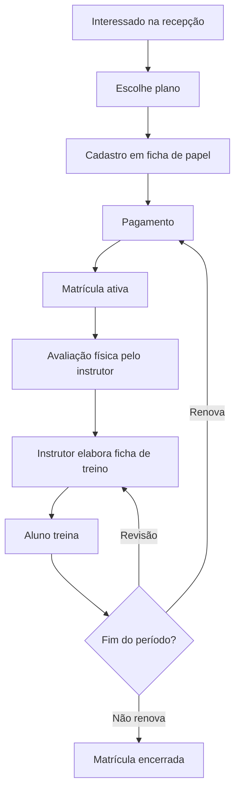

# Modelagem de Banco de Dados para a X Personal Studio
 
## Grupo
 
| Integrante | RGM |
|---|---|
| Guilherme Lima de Souza | 47622814 |
| Guilherme Miranda Sena | 47401672 |
| Guilherme Vilela Frassão | 47911522 |
| Nathan de Oliveira Tavares | 47916966 |
| Kaue Dogani Moreira | 47312998 |
 
> Versão: 0.2.0 · Status: Em desenvolvimento
 
---
 
## Sumário
1. [Introdução](#introdução)
2. [Caracterização da Organização](#1-caracterização-da-organização)
3. [Contato e Entrevista com a Organização](#2-contato-e-entrevista-com-a-organização)
4. [Processos de Negócio](#3-processos-de-negócio)
5. [SGBD e Collation](#4-sgbd-e-collation)
6. [Requisitos Funcionais e Não Funcionais](#5-requisitos)
7. [Regras de Negócio](#6-regras-de-negócio)
8. [Modelagem Conceitual e DER](#7-modelagem-conceitual-e-der)
9. [Dicionário de Dados](#8-dicionário-de-dados)
10. [Justificativa Técnica](#9-justificativa-técnica)
11. [Uso de Inteligência Artificial](#10-uso-de-inteligência-artificial)
---
 
## Introdução
 
Este projeto realiza a modelagem conceitual de um sistema de gerenciamento de informações para a **X Personal Studio**, academia de musculação localizada em São Paulo - SP. O escopo cobre o levantamento de requisitos, as regras de negócio, o Dicionário de Dados e o Modelo Entidade-Relacionamento (DER). A implementação física do banco e o desenvolvimento do sistema **não** fazem parte desta etapa.
 
---
 
## 1. Caracterização da Organização
 
| Item | Informação |
|---|---|
| **Nome** | X Personal Studio |
| **Natureza** | Academia de musculação, com fins lucrativos |
| **Localização** | R. Refinaria Mataripe, 577 - Vila Antonieta, São Paulo - SP, 03477-010 |
| **Contato** |(11) 97730-5571|
| **Porte** | Pequeno: ~3 funcionários e ~200 frequentadores inscritos |
| **Público** | Principalmente moradores do bairro |
| **Responsável contatado** | "Wolverine" - Dono do local |
 
### Problema identificado
Hoje o cadastro de frequentadores e as fichas de treino são mantidos em **papel**. Isso gera, na prática (⚠️ **[CONFIRMAR e exemplificar com casos relatados pelo responsável]**):
 
- dificuldade de localizar a ficha de um aluno e saber qual é a versão vigente;
- ausência de histórico de avaliações físicas comparável ao longo do tempo;
- controle de vencimento de plano e de pagamento sem consulta centralizada (ex.: saber quem está inadimplente ou com matrícula vencendo);
- risco de perda/extravio de dados pessoais e de saúde.
### Justificativa da escolha
Facilidade de acesso e comunicação com o responsável, e presença de relações claras entre planos, matrículas, pagamentos, treinos e avaliações, o que torna a organização um bom caso de modelagem. ⚠️ **[ACRESCENTAR 1–2 frases com a motivação específica do grupo]**
 
### Evidências
Fotos do ambiente e fotos com o dono localizadas no diretório [imgs](https://github.com/Ghost-NaNa/banco-de-dados-CCUNICID/tree/main/dicio_dados/imgs)
 
---
 
## 2. Contato e Entrevista com a Organização
 
| Item | Registro |
|---|---|
| **Data da visita/entrevista** | 11/09/2026 |
| **Forma** | Presencial |
| **Participantes do grupo** | Nathan de Oliveira, Guilherme Mirada e Guilherme Silva |
| **Entrevistado(a) e cargo** | Wolverine, Dono da academia |
| **Comprovação** | [Ver imagem](./dicio_dados/imgs/FotoDono.jpeg.jpeg) |
 
### Perguntas realizadas na 1ª visita (11/09/2026)
1. Há algum problema utilizar o espaço da academia e fazer perguntas aos funcionarios da academia?
2. Como funciona academia?

### Respostas registradas
1. Resposta:
   - "Wolverine" (Nós utilizamos esse apelido para registrar, pois ele não quer ser identificado), disse que não havia problema nenhum em ajudar e estava disposto a facilitar as coisas.
2. Resposta:
   - Wolverine nos disse que ela é totalmente focada em musculação, com 3 instrutores especialistas.
 
### Perguntas realizadas na 2ª visita
1. Como é feita a matricula?
2. Tem plano proprio e como são?
3. Como montam a ficha de treino?
4. O que cada funcionario tem permissão de fazer?

### Respostas registradas
1. Resposta: 
   - É realizada utilizando o CPF como base, e dados básicos - como nome completo, data de nascimento e foto do interessado.

2. Resposta:
   - Possuem um plano de inscrição proprio com 2 meios de pagamento, um sendo mensal e o outro anual.

3. Resposta:
   - Separa os exercicios de acordo com a necessidade do interresado, por exemplo, se ele quer ganher massa ou emagrecer teria uma ficha pronta para isso.

4. Resposta:
   - Todos os funcionários estão no mesmo plano de funções e resposabilidades, mesmo estando em andares diferentes da hierárquia. os funcionários, incluindo o dono, são personais também


## 3. Processos de Negócio
 
> Descrevem **como a academia opera hoje** (AS-IS).
 
### 3.1 Matrícula e pagamento
1. O interessado procura a recepção e escolhe um plano. `[CONFIRMAR]`
2. A recepção preenche a **ficha de papel** com nome, CPF e contato. `[CONFIRMAR]`
3. O primeiro pagamento é realizado e a data de início é anotada. `[CONFIRMAR]`
4. Nos meses seguintes, o pagamento é cobrado/conferido manualmente. `[CONFIRMAR]`
5. Ao fim do período, o aluno renova (nova matrícula) ou deixa a matrícula vencer. `[CONFIRMAR]`
### 3.2 Avaliação física
1. O aluno novo (e periodicamente) passa por avaliação com um instrutor. `[CONFIRMAR periodicidade]`
2. São medidos peso, altura e percentual de gordura, e anotadas observações médicas. `[CONFIRMAR]`
3. O registro vai para a ficha de papel do aluno; não há comparativo automático entre avaliações.
### 3.3 Ficha de treino
1. Com base na avaliação e no objetivo do aluno, um instrutor elabora a ficha. `[CONFIRMAR]`
2. A ficha lista os exercícios com séries e repetições e é entregue ao aluno. `[CONFIRMAR]`
3. Após um período, a ficha é revisada e uma nova é criada. `[CONFIRMAR intervalo]`
### 3.4 Fluxo geral
 

 
### 3.5 Problemas do processo atual e integração proposta
| Etapa | Problema hoje | O que o sistema resolve |
|---|---|---|
| Cadastro | Dados só em papel | Cadastro único e consultável |
| Pagamento | Conferência manual | Registro de pagamentos por matrícula, com status |
| Avaliação | Sem histórico comparável | Histórico por frequentador |
| Ficha | Versão vigente incerta | Fichas com data de criação/revisão e exercícios |
 
---
 
## 4. SGBD e Collation
 
| Item | Definição |
|---|---|
| **SGBD** | MySQL 8.0 |
| **Banco** | `db_gym_list` |
| **Character set** | `utf8mb4` |
| **Collation** | `utf8mb4_0900_ai_ci` (ignora acento e caixa: "José" = "jose") |
| **Motor** | InnoDB (chaves estrangeiras e transações) |
 
```sql
CREATE DATABASE db_gym_list
  CHARACTER SET utf8mb4
  COLLATE utf8mb4_0900_ai_ci;
```
 
---
 
## 5. Requisitos
 
### Requisitos Funcionais
| ID | Requisito |
|---|---|
| RF01 | Cadastrar frequentadores (nome, CPF, contato) |
| RF02 | Cadastrar planos (nome, duração, valor) |
| RF03 | Cadastrar matrículas (início, fim, status) vinculadas a um frequentador e a um plano |
| RF04 | Registrar pagamentos de cada matrícula (valor, vencimento, data de pagamento, forma, status) |
| RF05 | Consultar frequentadores com pagamento em atraso e matrículas próximas do vencimento |
| RF06 | Atualizar o status da matrícula (ativa, vencida, trancada, cancelada) |
| RF07 | Cadastrar funcionários (nome, CPF, cargo, especialidade, senha) |
| RF08 | Cadastrar exercícios |
| RF09 | Criar fichas de treino (objetivo, criação, revisão) para um frequentador, com o funcionário responsável |
| RF10 | Associar exercícios às fichas (séries, repetições, carga, ordem) |
| RF11 | Registrar avaliações físicas (data, peso, altura, % de gordura, observações médicas) |
| RF12 | Consultar o histórico de avaliações e de fichas de um frequentador |
 
### Requisitos Não Funcionais
| ID | Categoria | Requisito |
|---|---|---|
| RNF01 | Segurança | Senhas armazenadas somente como hash, nunca em texto puro |
| RNF02 | Integridade | Toda entidade possui identificador único (PK) e FKs com integridade referencial |
| RNF03 | Identificação | CPF único para frequentador e para funcionário |
| RNF04 | Confiabilidade | Backup periódico e transações para evitar perda ou alteração indevida |
| RNF05 | Usabilidade | Cadastros e consultas simples para a recepção e instrutores |
| RNF06 | Privacidade (LGPD) | Dados pessoais e observações médicas acessíveis apenas a perfis autorizados |
| RNF07 | Manutenibilidade | Estrutura extensível (ex.: controle de acesso por catraca) sem refazer o modelo |
| RNF08 | Rastreabilidade | Datas de criação, revisão, início, fim e avaliação armazenadas; alterações críticas registradas em log |
 
---
 
## 6. Regras de Negócio
 
> ⚠️ Propostas a partir do modelo; **validar cada uma com o responsável** e ajustar valores reais (prazos, tolerâncias).
 
| ID | Regra | Entidades |
|---|---|---|
| RN01 | Cada frequentador e cada funcionário é identificado por CPF único. | Frequentador, Funcionário |
| RN02 | Uma matrícula pertence a exatamente um frequentador e a exatamente um plano. | Matrícula |
| RN03 | Um frequentador pode ter várias matrículas ao longo do tempo (renovações), mas **no máximo uma com status "ativa"** por vez. | Matrícula |
| RN04 | A data final da matrícula é igual ou posterior à data de início. | Matrícula |
| RN05 | O status da matrícula assume apenas: ativa, vencida, trancada, cancelada. | Matrícula |
| RN06 | Uma matrícula é considerada "vencida" quando a data final passa sem renovação. ⚠️ [CONFIRMAR tolerância em dias] | Matrícula |
| RN07 | Cada pagamento pertence a exatamente uma matrícula e tem valor maior que zero. | Pagamento |
| RN08 | O status do pagamento é: pendente, pago ou atrasado; "pago" exige data de pagamento. | Pagamento |
| RN09 | Um pagamento "pendente" cujo vencimento passou é tratado como "atrasado". ⚠️ [CONFIRMAR consequência: bloqueio de acesso?] | Pagamento |
| RN10 | O valor do pagamento é registrado no momento da cobrança, mesmo que o preço do plano mude depois. | Pagamento, Plano |
| RN11 | Planos podem ser descontinuados (inativos), mas não excluídos se houver matrículas associadas. | Plano |
| RN12 | Toda ficha de treino pertence a um frequentador e é elaborada por um funcionário com cargo de instrutor. | Ficha, Funcionário |
| RN13 | A data de revisão da ficha é igual ou posterior à data de criação. | Ficha de Treino |
| RN14 | Uma ficha contém um ou mais exercícios; o mesmo exercício pode aparecer em várias fichas. | Ficha, Exercício |
| RN15 | Toda avaliação física pertence a exatamente um frequentador e é conduzida por exatamente um funcionário. | Avaliação |
| RN16 | Avaliações são mantidas como histórico: não são sobrescritas, uma nova avaliação gera novo registro. | Avaliação |
| RN17 | Peso, altura e percentual de gordura devem ser valores positivos (gordura entre 0 e 100). | Avaliação |
| RN18 | Não é permitido excluir frequentador que possua matrículas, fichas ou avaliações; ele é **inativado**. | Frequentador |
| RN19 | Observações médicas são dado sensível: só instrutores e administrador podem consultá-las. | Avaliação |
| RN20 | A senha do funcionário é armazenada em hash e nunca exibida. | Funcionário |
| RN21 | Dados de exemplo em documentos do projeto são fictícios. | — |
 
---
 
## 7. Modelagem Conceitual e DER
 
### Entidades
- **Frequentador:** pessoa que usa a academia (entidade central).
- **Plano:** oferta comercial (nome, duração, valor).
- **Matrícula:** vínculo de um frequentador com um plano em um período.
- **Pagamento:** cobrança associada a uma matrícula.
- **Funcionário:** profissional que realiza avaliações e elabora fichas.
- **Avaliação Física:** medição periódica do frequentador.
- **Ficha de Treino:** plano de treino de um frequentador.
- **Exercício:** catálogo de exercícios.
- **Ficha_Exercício:** associativa (N:M entre Ficha e Exercício) com séries, repetições, carga e ordem.
### Relacionamentos (mín,máx)
| Relacionamento | Lado A | Lado B |
|---|---|---|
| Frequentador **possui** Matrícula | Frequentador (0,N) | Matrícula (1,1) |
| Plano **compõe** Matrícula | Plano (0,N) | Matrícula (1,1) |
| Matrícula **gera** Pagamento | Matrícula (0,N) | Pagamento (1,1) |
| Frequentador **recebe** Ficha | Frequentador (0,N) | Ficha (1,1) |
| Funcionário **elabora** Ficha | Funcionário (0,N) | Ficha (1,1) |
| Ficha **contém** Exercício | Ficha (1,N) | Exercício (0,N) — via Ficha_Exercício |
| Frequentador **realiza** Avaliação | Frequentador (0,N) | Avaliação (1,1) |
| Funcionário **conduz** Avaliação | Funcionário (0,N) | Avaliação (1,1) |
 
### DER (Conceitual)

> [DER](./diagramas/conceitual_1.1.png)
 
---
 
## 8. Dicionário de Dados
 
O dicionário completo está em uma página HTML: **[dicio_dados/dicionario.hmtl](./dicio_dados/dicionario.md)**. Ele cobre SGBD/collation, versão, notação, expressões formais com leitura, tipos físicos, índices, log e papéis por operação (LGPD) para as 9 entidades do DER.
 
---
 
## 9. Justificativa Técnica
 
| Decisão | Alternativa considerada | Por que esta escolha |
|---|---|---|
| **Matrícula separada de Frequentador** | Guardar início/fim/status no próprio frequentador | Permite histórico de renovações sem sobrescrever dados |
| **Plano como entidade** | Escrever o nome do plano em cada matrícula | Evita repetição e permite alterar ou descontinuar planos |
| **Pagamento como entidade (1:N com Matrícula)** | Atributo "situação de pagamento" no frequentador | Uma matrícula tem várias parcelas; só assim há histórico e consulta de inadimplência (RF04/RF05) |
| **Valor copiado para o Pagamento** | Calcular sempre pelo valor atual do plano | Reajuste de plano não altera cobranças passadas (RN10) |
| **Avaliação com 1 frequentador e 1 funcionário (1:N, não N:M)** | Avaliação feita por vários profissionais | Avaliação é evento individual; evita ambiguidade de autoria. ⚠️ [CONFIRMAR na entrevista] |
| **Ficha ↔ Exercício N:M com associativa** | Campo de texto livre na ficha | Exercícios reutilizáveis e consultáveis; séries/repetições ficam na associativa |
| **Funcionário elabora Ficha** | Ficha sem autor | RF09 exige responsável; rastreabilidade |
| **Inativar em vez de excluir** | Exclusão física | Preserva histórico e evita registros órfãos (RN18) |
| **Hash de senha** | Senha em texto | Segurança e LGPD (RNF01) |
 
Não modelamos, nesta etapa, controle de acesso por catraca, aulas coletivas nem estoque, por não terem sido citados como necessidade pela organização. ⚠️ [CONFIRMAR]
 
---
 
## 10. Uso de Inteligência Artificial
 
| Item | Registro |
|---|---|
| **Ferramenta e etapa** | **ChatGPT** — estruturação inicial do README (requisitos, regras, justificativa). **Claude (Anthropic)** — revisão de consistência entre README, Dicionário de Dados e DER, e redação da versão 0.2.0 após a avaliação do professor. |
| **Motivação** | Organizar a documentação conforme o modelo de entrega e corrigir divergências entre os artefatos. |
| **Prompts utilizados** | "Revise esse arquivo (se referindo a o README) e veja se está consisntente"; "corrija erros de digitação, uso indevido de palavras e altere conteúdo se necessário"; |
| **Resposta recebida** | ChatGPT: revisou a consistência do arquivo e ainda melhorou a coerência dos textos. Claude: Encontrou poucos erros, e os poucos que encontrou, corrigiu sem mais|
| **Fontes consultadas e verificadas** | Comparando com o as informaçẽos já coletadas para evitar possiveis alucinações da IA |
| **Trechos rejeitados ou corrigidos** | ⚠️ **[PREENCHER com casos reais, ex.: "A IA sugeriu campo `exercicios` em texto livre na ficha; rejeitamos e criamos Exercício e Ficha_Exercício"; "A IA propôs tolerância de 5 dias de atraso; substituímos pelo prazo informado pela academia"]** |
| **Justificativa da escolha final** | Adotamos as sugestões compatíveis com os processos observados e o DER; o que não foi confirmado com a organização ficou marcado como a validar. |
| **Reflexão crítica** | A IA tende a generalizar processos de academias; por isso as regras e os fluxos foram confrontados com a entrevista. As decisões finais são do grupo. |
