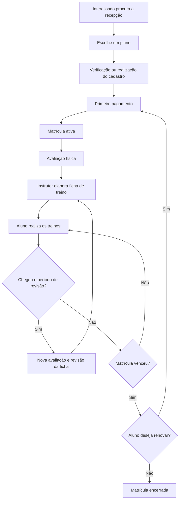

# Modelagem de Banco de Dados para a X Personal Studio
 
## Grupo
 
| Integrante | RGM |
|---|---|
| Guilherme Lima de Souza | 47622814 |
| Guilherme Miranda Sena | 47401672 |
| Guilherme Vilela Frassão | 47911522 |
| Nathan de Oliveira Tavares | 47916966 |
| Kaue Dogani Moreira | 47312998 |
 
> Versão: 0.2.0 · Status: Em desenvolvimento
 
---
 
## Sumário
1. [Introdução](#introdução)
2. [Caracterização da Organização](#1-caracterização-da-organização)
3. [Contato e Entrevista com a Organização](#2-contato-e-entrevista-com-a-organização)
4. [Processos de Negócio](#3-processos-de-negócio)
5. [SGBD e Collation](#4-sgbd-e-collation)
6. [Requisitos Funcionais e Não Funcionais](#5-requisitos)
7. [Regras de Negócio](#6-regras-de-negócio)
8. [Modelagem Conceitual e DER](#7-modelagem-conceitual-e-der)
9. [Dicionário de Dados](#8-dicionário-de-dados)
10. [Justificativa Técnica](#9-justificativa-técnica)
11. [Uso de Inteligência Artificial](#10-uso-de-inteligência-artificial)
---
 
## Introdução
 
Este projeto realiza a modelagem conceitual de um sistema de gerenciamento de informações para a **X Personal Studio**, academia de musculação localizada em São Paulo - SP. O escopo cobre o levantamento de requisitos, as regras de negócio, o Dicionário de Dados e o Modelo Entidade-Relacionamento (DER). Até o presente momento, implementação física do banco e o desenvolvimento do sistema **não** fazem parte desta etapa
 
---
 
## 1. Caracterização da Organização
 
| Item | Informação |
|---|---|
| **Nome** | X Personal Studio |
| **Natureza** | Academia de musculação, com fins lucrativos |
| **Localização** | R. Refinaria Mataripe, 577 - Vila Antonieta, São Paulo - SP, 03477-010 |
| **Contato** |(11) 97730-5571|
| **Porte** | Pequeno: ~3 funcionários e ~200 frequentadores inscritos |
| **Público** | Principalmente moradores do bairro |
| **Responsável contatado** | "Wolverine" - Dono do local |
 
### Problema identificado
Hoje o cadastro de frequentadores é feito por um sistema terceiro e as fichas de treino são guardadas em papel, e isso, por mais intuitivo que seja, gera alguns problemas.

   - De acordo com o próprio dono, "fico perdido quando as fichas acumulam demais". Ou seja, quando tem um certo volume de fichas feitas, é muito papel para organizar e acaba complicando.
   - Se as fichas são em papel, logicamente precisam de espaço fisico, e por ser um local pequeno, não é uma tarefa fácil

### Justificativa da escolha
É um local de fácil acesso e comunicação com o responsável, e presença de relações claras entre planos, matrículas, pagamentos, treinos e avaliações, o que torna a organização um bom caso de modelagem.

Possuí um fluxo relativamente constante de informações sobre os alunos e intrutores, tornando necessário um banco de dados que facilite o armazenamento (e que seja unificado), a consulta e a atualização desses registros.

Vale ressaltar que escolha permite trabalhar com diferentes entidades e relacionamentos, como alunos, instrutores, exercícios e fichas de treino, proporcionando uma boa oportunidade de aplicar na prática os conceitos de modelagem de banco de dados.

 
### Evidências
Fotos do ambiente e fotos com o dono localizadas no diretório [imgs](https://github.com/Ghost-NaNa/banco-de-dados-CCUNICID/tree/main/dicio_dados/imgs)
 
---
 
## 2. Contato e Entrevista com a Organização
 
| Item | Registro |
|---|---|
| **Data da visita/entrevista** | 11/09/2026 |
| **Forma** | Presencial |
| **Participantes do grupo** | Nathan de Oliveira, Guilherme Mirada e Guilherme Silva |
| **Entrevistado(a) e cargo** | Wolverine, Dono da academia |
| **Comprovação** | [Ver imagem](./dicio_dados/imgs/FotoDono.jpeg.jpeg) |
 
### Perguntas realizadas na 1ª visita (11/09/2026)
1. Há algum problema utilizar o espaço da academia e fazer perguntas aos funcionarios da academia?
2. Como funciona academia?

### Respostas registradas
1. Resposta:
   - "Wolverine" (Nos deu esse apelido para registrar, pois não quer ser identificado), disse que não havia problema nenhum em ajudar e estava disposto a facilitar as coisas.
2. Resposta:
   - Wolverine nos disse que ela é totalmente focada em musculação, com 3 instrutores especialistas.
 
### Perguntas realizadas na 2ª visita
1. Como é feita a matricula?
2. Tem plano proprio e como são?
3. Como montam a ficha de treino?
4. O que cada funcionario tem permissão de fazer?

### Respostas registradas
1. Resposta: 
   - É realizada utilizando o CPF como base, e dados básicos - como nome completo, data de nascimento e foto do interessado.

2. Resposta:
   - Possuem um plano de inscrição proprio com 2 meios de pagamento, um sendo mensal e o outro anual.

3. Resposta:
   - Separa os exercicios de acordo com a necessidade do interresado, por exemplo, se ele quer ganhar massa ou emagrecer seria feito uma ficha pronta, em papel, para isso.

4. Resposta:
   - Todos os funcionários estão no mesmo plano de funções e resposabilidades, mesmo estando em andares diferentes da hierárquia. os funcionários, incluindo o dono, são, aparentemente, personais também


## 3. Processos de Negócio

Descrevem como a academia opera atualmente (AS-IS), com base nas informações obtidas durante as entrevistas com o responsável pela organização.

### 3.1 Matrícula e pagamento

1. O interessado procura a academia para conhecer os planos disponíveis.
2. A academia oferece planos de inscrição mensal e anual.
3. O cadastro do frequentador é realizado por meio de um sistema de terceiros, utilizando o CPF como identificação e registrando informações como nome completo, data de nascimento e foto.
4. O frequentador escolhe o plano desejado e realiza sua inscrição.
5. Os detalhes sobre as formas de pagamento, cobrança e renovação precisam ser confirmados com o responsável pela academia.

### 3.2 Avaliação física

1. O processo de avaliação física não foi detalhado durante as entrevistas realizadas.
2. A existência de avaliações periódicas, os procedimentos utilizados e as informações registradas precisam ser confirmados com o responsável pela academia.
3. A modelagem prevê o registro de avaliações físicas para possibilitar o acompanhamento do histórico e da evolução dos frequentadores.

### 3.3 Ficha de treino

1. O frequentador informa seus objetivos, como ganhar massa muscular ou emagrecer.
2. Um instrutor seleciona os exercícios de acordo com as necessidades e os objetivos apresentados pelo frequentador.
3. A ficha de treino é elaborada em papel e entregue ao frequentador.
4. As fichas são armazenadas fisicamente, o que pode dificultar sua organização e consulta quando há um grande volume de documentos.
5. A periodicidade de revisão e atualização das fichas precisa ser confirmada com o responsável pela academia.

### 3.4 Fluxo geral


 
### 3.5 Problemas do processo atual e integração proposta

| Etapa | Problema atual | Benefício esperado com o banco de dados |
|---|---|---|
| Cadastro | Dados dos frequentadores armazenados em sistema de terceiros, sem integração com as demais informações da academia. | Centralização dos dados dos frequentadores em um banco de dados próprio. |
| Pagamento | Necessidade de organizar e consultar as informações financeiras vinculadas às matrículas. | Registro dos pagamentos por matrícula, com valores, vencimentos e status. |
| Avaliação física | Necessidade de manter um histórico organizado das avaliações dos frequentadores. | Armazenamento e consulta do histórico de avaliações físicas. |
| Ficha de treino | Fichas armazenadas em papel, dificultando a organização e a consulta. | Armazenamento digital das fichas, exercícios e informações de revisão. |
| Matrícula | Necessidade de organizar os dados dos planos e das inscrições dos frequentadores. | Controle das matrículas, planos, datas e situações de cada frequentador. |
---
 
## 4. SGBD e Collation
 
| Item | Definição |
|---|---|
| **SGBD** | MySQL 8.0 |
| **Banco** | `db_gym_list` |
| **Character set** | `utf8mb4` |
| **Collation** | `utf8mb4_0900_ai_ci` (ignora acento e caixa: "José" = "jose") |
| **Motor** | InnoDB (chaves estrangeiras e transações) |
 
```sql
CREATE DATABASE db_gym_list
  CHARACTER SET utf8mb4
  COLLATE utf8mb4_0900_ai_ci;
```

**Repositório do projeto**: O código-fonte, o scripts SQL e relacionado ao desenvolvimento do banco de dados estão disponíveis no link abaixo.

> [script](./docs/script.sql)


---
 
## 5. Requisitos
 
### Requisitos Funcionais
| ID | Requisito |
|---|---|
| RF01 | Cadastrar frequentadores (nome, CPF, contato) |
| RF02 | Cadastrar planos (nome, duração, valor) |
| RF03 | Cadastrar matrículas (início, fim, status) vinculadas a um frequentador e a um plano |
| RF04 | Registrar pagamentos de cada matrícula (valor, vencimento, data de pagamento, forma, status) |
| RF05 | Consultar frequentadores com pagamento em atraso e matrículas próximas do vencimento |
| RF06 | Atualizar o status da matrícula (ativa, vencida, trancada, cancelada) |
| RF07 | Cadastrar funcionários (nome, CPF, cargo, especialidade, senha) |
| RF08 | Cadastrar exercícios |
| RF09 | Criar fichas de treino (objetivo, criação, revisão) para um frequentador, com o funcionário responsável |
| RF10 | Associar exercícios às fichas (séries, repetições, carga, ordem) |
| RF11 | Registrar avaliações físicas (data, peso, altura, % de gordura, observações médicas) |
| RF12 | Consultar o histórico de avaliações e de fichas de um frequentador |
 
### Requisitos Não Funcionais
| ID | Categoria | Requisito |
|---|---|---|
| RNF01 | Segurança | Senhas armazenadas somente como hash, nunca em texto puro |
| RNF02 | Integridade | Toda entidade possui identificador único (PK) e FKs com integridade referencial |
| RNF03 | Identificação | CPF único para frequentador e para funcionário |
| RNF04 | Confiabilidade | Backup periódico e transações para evitar perda ou alteração indevida |
| RNF05 | Usabilidade | Cadastros e consultas simples para a recepção e instrutores |
| RNF06 | Privacidade (LGPD) | Dados pessoais e observações médicas acessíveis apenas a perfis autorizados |
| RNF07 | Manutenibilidade | Estrutura extensível (ex.: controle de acesso por catraca) sem refazer o modelo |
| RNF08 | Rastreabilidade | Datas de criação, revisão, início, fim e avaliação armazenadas; alterações críticas registradas em log |
 
---
 
## 6. Regras de Negócio
  
| ID | Regra | Entidades |
|---|---|---|
| RN01 | Cada frequentador e cada funcionário é identificado por CPF único. | Frequentador, Funcionário |
| RN02 | Uma matrícula pertence a exatamente um frequentador e a exatamente um plano. | Matrícula |
| RN03 | Um frequentador pode ter várias matrículas ao longo do tempo (renovações), mas **no máximo uma com status "ativa"** por vez. | Matrícula |
| RN04 | A data final da matrícula é igual ou posterior à data de início. | Matrícula |
| RN05 | O status da matrícula assume apenas: ativa, vencida, trancada, cancelada. | Matrícula |
| RN06 | Uma matrícula é considerada "vencida" quando a data final passa sem renovação. | Matrícula |
| RN07 | Cada pagamento pertence a exatamente uma matrícula e tem valor maior que zero. | Pagamento |
| RN08 | O status do pagamento é: pendente, pago ou atrasado; "pago" exige data de pagamento. | Pagamento |
| RN09 | Um pagamento "pendente" cujo vencimento passou é tratado como "atrasado". Consequência: bloqueio de acesso?] | Pagamento |
| RN10 | O valor do pagamento é registrado no momento da cobrança, mesmo que o preço do plano mude depois. | Pagamento, Plano |
| RN11 | Planos podem ser descontinuados (inativos), mas não excluídos se houver matrículas associadas. | Plano |
| RN12 | Toda ficha de treino pertence a um frequentador e é elaborada por um funcionário com cargo de instrutor. | Ficha, Funcionário |
| RN13 | A data de revisão da ficha é igual ou posterior à data de criação. | Ficha de Treino |
| RN14 | Uma ficha contém um ou mais exercícios; o mesmo exercício pode aparecer em várias fichas. | Ficha, Exercício |
| RN15 | Toda avaliação física pertence a exatamente um frequentador e é conduzida por exatamente um funcionário. | Avaliação |
| RN16 | Avaliações são mantidas como histórico: não são sobrescritas, uma nova avaliação gera novo registro. | Avaliação |
| RN17 | Peso, altura e percentual de gordura devem ser valores positivos (gordura entre 0 e 100). | Avaliação |
| RN18 | Não é permitido excluir frequentador que possua matrículas, fichas ou avaliações; ele é **inativado**. | Frequentador |
| RN19 | Observações médicas são dado sensível: só instrutores e administrador podem consultá-las. | Avaliação |
| RN20 | A senha do funcionário é armazenada em hash e nunca exibida. | Funcionário |
| RN21 | Dados de exemplo em documentos do projeto são fictícios. | — |
 
---
 
## 7. Modelagem Conceitual e DER
 
### Entidades
- **Frequentador:** pessoa que usa a academia (entidade central).
- **Plano:** oferta comercial (nome, duração, valor).
- **Matrícula:** vínculo de um frequentador com um plano em um período.
- **Pagamento:** cobrança associada a uma matrícula.
- **Funcionário:** profissional que realiza avaliações e elabora fichas.
- **Avaliação Física:** medição periódica do frequentador.
- **Ficha de Treino:** plano de treino de um frequentador.
- **Exercício:** catálogo de exercícios.
- **Ficha_Exercício:** associativa (N:M entre Ficha e Exercício) com séries, repetições, carga e ordem.
### Relacionamentos (mín,máx)
| Relacionamento | Lado A | Lado B |
|---|---|---|
| Frequentador **possui** Matrícula | Frequentador (0,N) | Matrícula (1,1) |
| Plano **compõe** Matrícula | Plano (0,N) | Matrícula (1,1) |
| Matrícula **gera** Pagamento | Matrícula (0,N) | Pagamento (1,1) |
| Frequentador **recebe** Ficha | Frequentador (0,N) | Ficha (1,1) |
| Funcionário **elabora** Ficha | Funcionário (0,N) | Ficha (1,1) |
| Ficha **contém** Exercício | Ficha (1,N) | Exercício (0,N) — via Ficha_Exercício |
| Frequentador **realiza** Avaliação | Frequentador (0,N) | Avaliação (1,1) |
| Funcionário **conduz** Avaliação | Funcionário (0,N) | Avaliação (1,1) |
 
### DER (Conceitual)

> [DER](./diagramas/conceitual_1.1.png)
 
---
 
## 8. Dicionário de Dados
 
O dicionário completo está em uma página HTML: **[dicio_dados/dicionario.hmtl](./dicio_dados/dicionario.md)**. Ele cobre SGBD/collation, versão, notação, expressões formais com leitura, tipos físicos, índices, log e papéis por operação (LGPD) para as 9 entidades do DER.
 
---
 
## 9. Justificativa Técnica
 
| Decisão | Alternativa considerada | Por que esta escolha |
|---|---|---|
| **Matrícula separada de Frequentador** | Guardar início/fim/status no próprio frequentador | Permite histórico de renovações sem sobrescrever dados |
| **Plano como entidade** | Escrever o nome do plano/tipo em cada matrícula | Evita repetição e permite alterar ou descontinuar planos |
| **Pagamento como entidade (1:N com Matrícula)** | Atributo "situação de pagamento" no frequentador | Uma matrícula tem várias parcelas; só assim há histórico e consulta de inadimplência (RF04/RF05) |
| **Valor copiado para o Pagamento** | Calcular sempre pelo valor atual do plano | Reajuste de plano não altera cobranças passadas (RN10) |
| **Avaliação com 1 frequentador e 1 intrutor (1:N, não N:M)** | Avaliação podendo ser feita por vários profissionais | Avaliação é evento individual; evita ambiguidade de autoria. |
| **Ficha ↔ Exercício N:M com associativa** | Campo de texto livre na ficha | Exercícios reutilizáveis e consultáveis; séries/repetições ficam na associativa |
| **Funcionário elabora Ficha** | Ficha sem autor | RF09 exige responsável; rastreabilidade |
| **Inativar em vez de excluir** | Exclusão física | Preserva histórico e evita registros órfãos (RN18) |
| **Hash de senha** | Senha em texto | Segurança e LGPD (RNF01) |
 
Não modelamos, nesta etapa, controle de acesso por catraca e nem estoque, por não terem sido citados como necessidade pela organização.
 
---
 
## 10. Uso de Inteligência Artificial
 
**README**
| Item | Registro |
|---|---|
| **Ferramenta e etapa** | **ChatGPT** — estruturação inicial do README (requisitos, regras, justificativa). **Claude (Anthropic)** — revisão de consistência entre README, Dicionário de Dados e DER, e redação da versão 0.2.0 após a avaliação do professor. |
| **Motivação** | Organizar a documentação conforme o modelo de entrega e corrigir divergências entre os artefatos. |
| **Prompts utilizados** | "Revise esse arquivo (se referindo a o README) e veja se está consisntente"; "corrija erros de digitação, uso indevido de palavras e altere conteúdo se necessário"; |
| **Resposta recebida** | ChatGPT: revisou a consistência do arquivo e ainda melhorou a coerência dos textos. Claude: Encontrou poucos erros, e os poucos que encontrou, corrigiu sem mais|
| **Fontes consultadas e verificadas** | Comparando com o as informaçẽos já coletadas para evitar possiveis alucinações da IA |
| **Trechos rejeitados ou corrigidos** | Tanto o chatGPT quanto o Claude, eventualmente acabaram alucinando nas informações, como aconteceu, de alterar de forma exagerada na quantidade de intrutores. |
| **Justificativa da escolha final** | Adotamos as sugestões compatíveis com os processos observados e o DER; o que não foi confirmado com a organização ficou marcado como a validar. |
| **Reflexão crítica** | A IA tende a generalizar processos de academias; por isso as regras e os fluxos foram confrontados com a entrevista. As decisões finais são do grupo. |

**Massa de Dados**
| Item | Registro |
|---|---|
| **Ferramenta e etapa** | **ChatGPT Plus** — estruturação de uma massa de dados fictícia baseada nos dados obtidos durante a primeira e a segunda entrevista, com a mesma contendo todos os dados necessários para completar nossa base de dados e tornar o script em SQl 100% funcional. |
| **Motivação** | Otimizar o tempo para poder focar no refinamento de certas partes do projeto. |
| **Prompts utilizados** | Com base no banco de dados da X Personal Studio e nas informações do repositório https://github.com/Ghost-NaNa/banco-de-dados-CCUNICID, crie uma massa de dados fictícia utilizando MySQL 8.0. O banco deve conter exatamente 3 funcionários e 210 frequentadores, além de registros de planos, matrículas, pagamentos, exercícios, fichas de treino e avaliações físicas. Utilize apenas dados fictícios e respeite as regras de negócio, os relacionamentos e as restrições já definidos no projeto. Inclua diferentes situações de matrículas e pagamentos para permitir testes. Não altere a estrutura das tabelas e organize o código SQL para que possa ser executado sem erros. Ao final, adicione consultas para verificar se os dados foram inseridos corretamente. |
| **Resposta recebida** | ChatGPT: Criei uma massa de dados fictícia para a X Personal Studio, compatível com o código SQL que desenvolvemos anteriormente, contemplando os 3 funcionários e 210 frequentadores. |
| **Fontes consultadas e verificadas** | Para termos 100% de certeza do que estava sendo feito naquela parte usamos como base de analíse vídeos do youtube que ensinavam a mexer com MySQL 8.0 e os arquivos disponibilizados pelo professor no drive. |
| **Trechos rejeitados ou corrigidos** | Alteramos por completo a estrutura dos IDs para se adequar mais ao nosso planejamento inicial e torna-lo mais simples, além de fazermos alterações simples em relação as especialidades de cada instrutor e na parte dos dados dos frequentadores. |
| **Justificativa da escolha final** | Para a massa de dados foi a escolha mais eficaz, já que após uma revisão a mesma já estava pronta para uso e pela velocidade de criação tivemos mais tempo para focar em outros aspectos do nosso projeto. |
| **Reflexão crítica** | Para criação de dados fictícios em larga escala as IAs são uma ótima escolha para quem quer otimizar seu tempo. |

**Análise e correções do Script em SQL**
| Item | Registro |
|---|---|
| **Ferramenta e etapa** | **ChatGPT Plus** — verificar a qualidade do script e se existia a necessidade de fazer alterações |
| **Motivação** | Por ser minha primeira vez utilizando SQL optei por ter um apoio para verificar a qualidade do meu código |
| **Prompts utilizados** | Com base no script SQL desenvolvido para a X Personal Studio e nas informações do repositório https://github.com/Ghost-NaNa/banco-de-dados-CCUNICID, faça uma análise da qualidade do código utilizando os requisitos do projeto como referência. Verifique se as tabelas, os relacionamentos, as chaves primárias e estrangeiras e as restrições estão corretos. Analise também a organização do código, a integridade dos dados e a compatibilidade com MySQL 8.0. Identifique possíveis erros, inconsistências ou melhorias, verificando se o código atende às regras de negócio estabelecidas. |
| **Resposta recebida** | ChatGPT: Relatório de Verificação de Qualidade do Código SQL
Projeto: Banco de Dados — X Personal Studio
SGBD: MySQL 8.0
Resultado da análise: Código bem estruturado, com alguns pontos que precisam de ajustes. |
| **Fontes consultadas e verificadas** | Para confirmar que a IA não estava alucinando nas respostas, voltei aos conteúdos que utilizei na criação do script e verifiquei cada uma das respostas de melhoria no código. |
| **Trechos rejeitados ou corrigidos** | Tive algumas reselvas apenas na forma como ela queria organizar a estrutura do código, mas encontrei um meio termo que batia com os conteúdos que estava utilizando. |
| **Justificativa da escolha final** | Levei muito em consideração a forma como foi feita a primeira entrega então optei por levar mais tempo nessa sessão para garantir uma qualidade alta. |
| **Reflexão crítica** | Acredito que para uma revisão e análise de código as IAs sempre são bem vindas, para otimização de tempo. |

**Regras de negocio**
Escrita

| Item | Registro |
| --- | --- |
| **Ferramenta e etapa** | **Claude** — auxiliar na elaboração, organização e validação das regras de negócio do sistema X Personal Studio. |
| **Motivação** | Como as regras de negócio são fundamentais para definir o funcionamento do sistema, optei por utilizar a IA como apoio para estruturar os processos e garantir que as etapas representassem corretamente a rotina de uma academia. |
| **Prompts utilizados** | Com base na proposta do projeto X Personal Studio, ajude a identificar e estruturar as principais regras de negócio de um sistema de gerenciamento de academia. Considere os processos de cadastro de alunos, escolha de planos, pagamento, ativação e renovação de matrículas, avaliações físicas, elaboração de fichas de treino e acompanhamento dos alunos. Organize as regras de maneira clara e coerente, considerando as condições e os possíveis cenários de cada processo. |
| **Resposta recebida** | Claude: Sugestão de um conjunto de regras de negócio para o X Personal Studio, contemplando o processo de matrícula, pagamentos, avaliações físicas, elaboração e revisão de fichas de treino, renovação e encerramento de matrículas. |
| **Fontes consultadas e verificadas** | Foram utilizadas como referência as informações e os requisitos definidos para o projeto, além dos materiais de estudo sobre modelagem de banco de dados e levantamento de requisitos. |
| **Trechos rejeitados ou corrigidos** | Algumas sugestões precisaram ser adaptadas para representar melhor a realidade dos processos definidos para a academia. Também foram ajustadas algumas condições para evitar ambiguidades no funcionamento das matrículas e dos planos. |
| **Justificativa da escolha final** | Optei por aproveitar as sugestões que estavam de acordo com a proposta do projeto, realizando adaptações para manter a coerência entre as regras de negócio, os processos da academia e a futura implementação do banco de dados. |
| **Reflexão crítica** | A utilização da IA foi útil para organizar as ideias e identificar situações que poderiam passar despercebidas durante a elaboração das regras de negócio. Entretanto, foi importante revisar as sugestões e tomar as decisões finais com base nos requisitos do projeto, evitando aceitar automaticamente todas as recomendações. |
